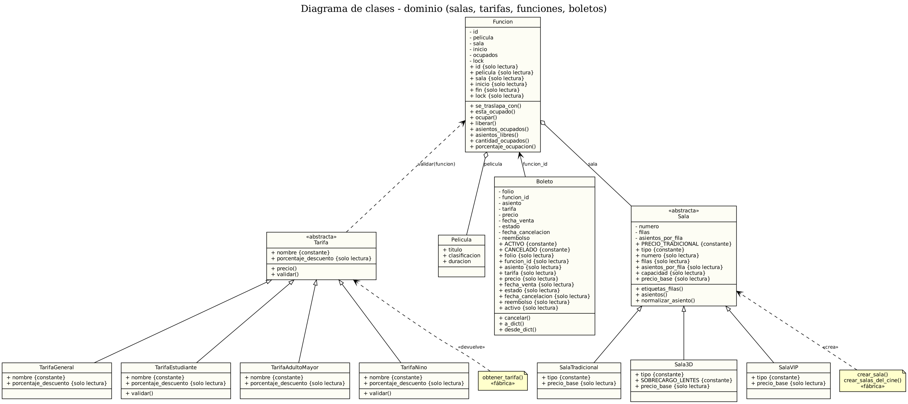
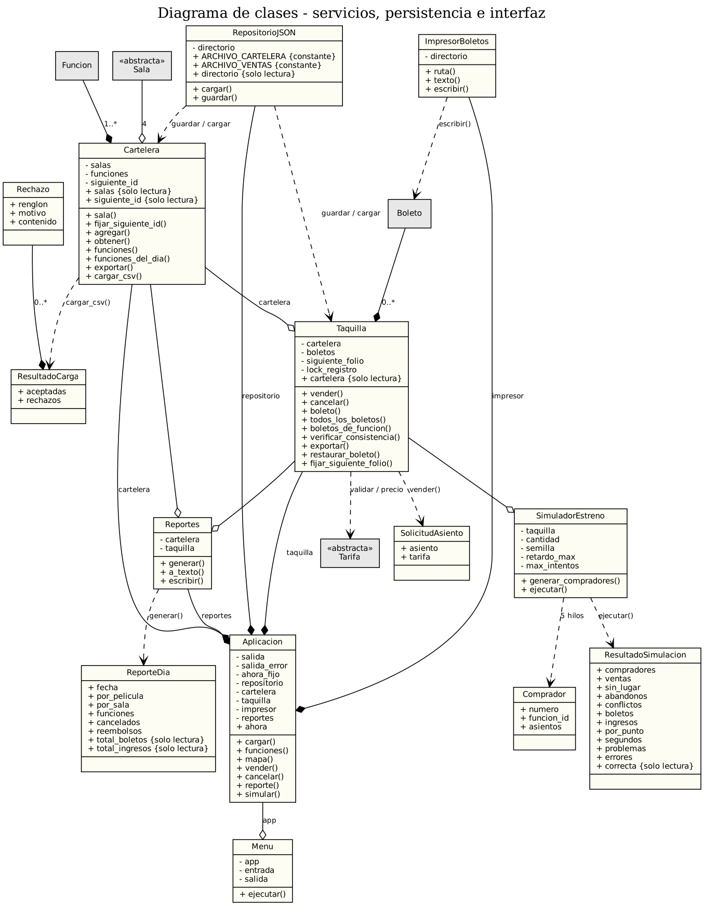
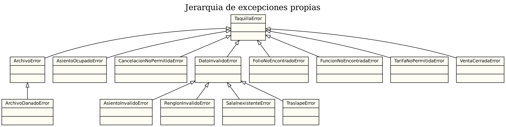
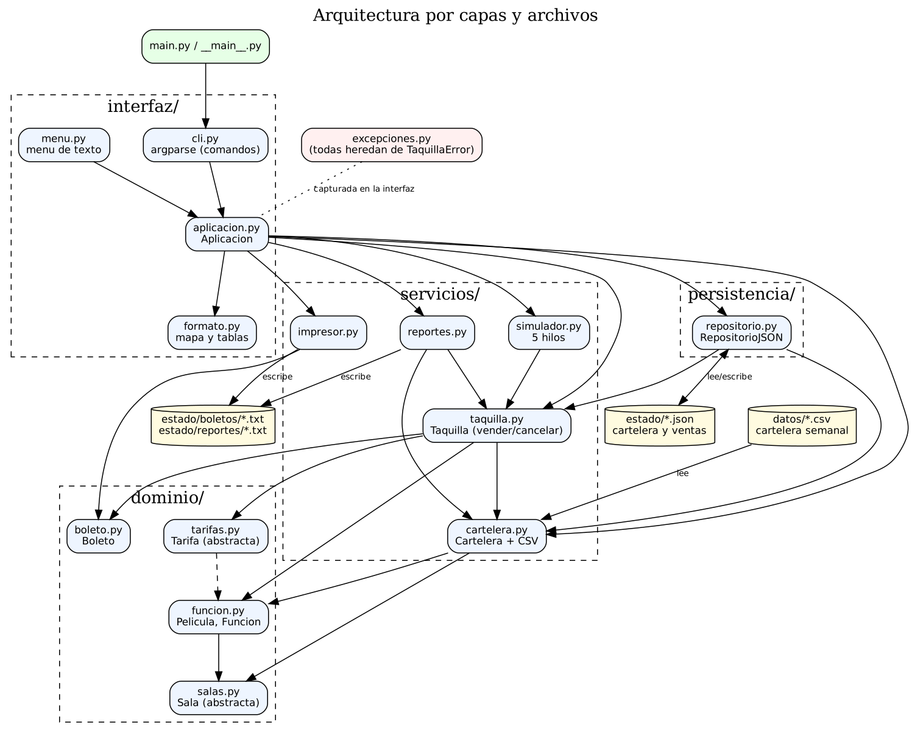
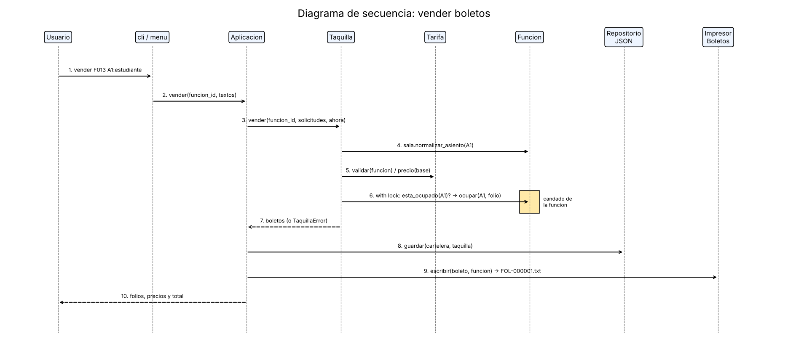
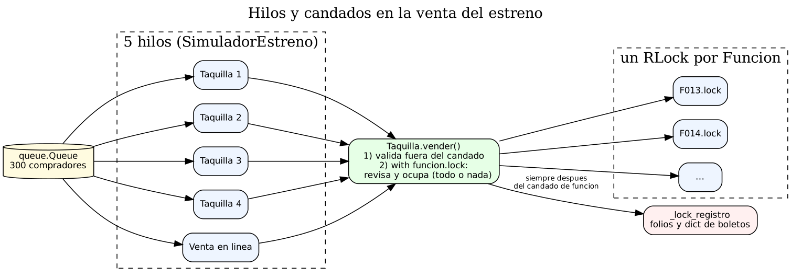
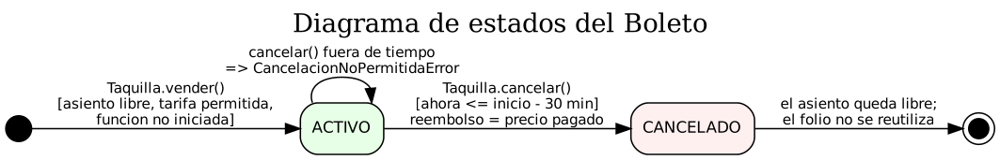

# Documento de diseño – Taquilla de un cine

## 1. Diagramas UML

Todos los diagramas están en [`uml/`](uml/) y se **generan a partir del código** con
`python docs/uml/generar_uml.py` (atributos y métodos se leen de las clases reales con `inspect` y `ast`;
las relaciones están declaradas en el script; requiere Graphviz y matplotlib solo para regenerarlos). Así
coinciden con el código entregado: si el código cambia, se vuelven a generar.

### 1.1 Diagrama de clases del dominio — `uml/clases_dominio.png`

**Qué muestra:** las dos jerarquías de herencia (`Sala` → `SalaTradicional`, `Sala3D`, `SalaVIP`; `Tarifa` →
`TarifaGeneral`, `TarifaEstudiante`, `TarifaAdultoMayor`, `TarifaNino`), y cómo `Funcion` agrega una `Pelicula`
y una `Sala` y protege su mapa de asientos. `Boleto` apunta a su función por identificador. Las notas amarillas
son las fábricas (`crear_sala`, `obtener_tarifa`).
**Por qué se eligió:** es el núcleo del problema (precios, tarifas y mapa de asientos). Muestra dónde está cada
regla del enunciado: el precio por tipo de sala en `Sala.precio_base`, el descuento y las restricciones de cada
tarifa en `Tarifa.precio/validar`.

### 1.2 Diagrama de clases de servicios, persistencia e interfaz — `uml/clases_servicios.png`

**Qué muestra:** quién posee a quién. Rombo relleno = composición (`Cartelera` posee sus `Funcion`,
`Taquilla` posee sus `Boleto`, `Aplicacion` posee repositorio, impresor, reportes, cartelera y taquilla);
rombo vacío = agregación (la `Taquilla` y los `Reportes` usan una `Cartelera` que no les pertenece; `Cartelera`
agrega las `Sala`; `Menu` usa una `Aplicacion`); línea punteada = dependencia (`Taquilla` usa `Tarifa` y
`SolicitudAsiento`). Los recuadros grises son clases del diagrama anterior.
**Por qué se eligió:** reparte responsabilidades entre capas y deja ver que `Aplicacion` es el único punto que
conoce a todas, y que el menú y la CLI comparten la misma lógica.

### 1.3 Jerarquía de excepciones — `uml/excepciones.png`

**Qué muestra:** todas las excepciones heredan de `TaquillaError`; `DatoInvalidoError` agrupa los errores de
datos (renglón inválido, sala inexistente, traslape, asiento inválido) y `ArchivoError` los de archivos.
**Por qué se eligió:** la interfaz captura `TaquillaError` una sola vez y muestra un mensaje en vez de un
traceback; los servicios pueden capturar un grupo (por ejemplo, la carga del CSV captura `TaquillaError` por renglón).

### 1.4 Arquitectura por capas — `uml/arquitectura.png`

**Qué muestra:** módulos, dependencias (solo hacia abajo) y los archivos que lee y escribe el programa.
**Por qué se eligió:** responde "cómo se conecta todo": `main → cli/menu → Aplicacion → servicios → dominio`.

### 1.5 Diagrama de secuencia de una venta — `uml/secuencia_venta.png`

**Qué muestra:** el recorrido de `vender F013 A1:estudiante`: validación del asiento y de la tarifa fuera del
candado, sección crítica con el candado de la función (revisar y ocupar), y después guardar y escribir el boleto.
**Por qué se eligió:** es la operación más delicada (reglas + concurrencia); el diagrama deja claro el orden.

### 1.6 Hilos y candados — `uml/concurrencia.png`

**Qué muestra:** la cola de 300 compradores, los 5 hilos, `Taquilla.vender` y los candados (uno por función
más uno para el registro de boletos y folios).
**Por qué se eligió:** justifica el diseño de bloqueo y el orden de candados que evita interbloqueos.

### 1.7 Diagrama de estados del boleto — `uml/estados_boleto.png`

**Qué muestra:** un boleto nace `ACTIVO` al venderse y pasa a `CANCELADO` solo si la cancelación llega a más
tardar 30 minutos antes de la función.
**Por qué se eligió:** resume la regla de cancelación, que depende del tiempo.

## 2. Decisiones de diseño

| Concepto | Dónde se usa | Qué problema resuelve |
|---|---|---|
| **Encapsulamiento** | `Funcion` guarda su mapa de asientos en `_ocupados` y solo se modifica con `ocupar`/`liberar` (con candado); `Boleto` expone solo propiedades de lectura y su único cambio permitido es `cancelar()`; `Pelicula` es un `dataclass(frozen=True)` que valida sus datos al crearse; `Sala` valida filas/asientos y normaliza `a1` → `A1`; `Taquilla` oculta su registro y su contador de folios. | Nadie puede dejar un asiento vendido sin boleto, cambiar el precio de un boleto ya emitido o crear una película con datos inválidos. Las invariantes viven en un solo lugar. |
| **Herencia y clases abstractas** | `Sala` (ABC con `precio_base` abstracto) → `SalaTradicional`, `Sala3D`, `SalaVIP`; `Tarifa` (ABC con `porcentaje_descuento` abstracto) → cuatro tarifas. | Evita `if tipo == "3D"` repartidos por el código: agregar un tipo de sala o de tarifa es agregar una clase. Una `Sala`/`Tarifa` genérica no tiene sentido, por eso son abstractas y no se pueden instanciar (hay prueba). |
| **Composición y agregación** | Composición: `Cartelera` ◆ `Funcion`, `Taquilla` ◆ `Boleto`, `Aplicacion` ◆ (repositorio, impresor, reportes, cartelera, taquilla). Agregación: `Funcion` ◇ `Sala`/`Pelicula`, `Cartelera` ◇ `Sala`, `Taquilla`/`Reportes`/`Simulador` ◇ `Cartelera`/`Taquilla`. | Una película y una sala existen sin importar cuántas funciones las usan (agregación); una función o un boleto no tienen sentido fuera de su cartelera o taquilla (composición). Se prefiere composición a herencia para `Aplicacion`, `Taquilla` y `Reportes`: colaboran con otros objetos, no *son* esos objetos. |
| **Polimorfismo** | `Tarifa.precio()`/`validar()`: `Taquilla.vender` los llama sin saber qué tarifa es (niño rechaza VIP y clasificación C; estudiante rechaza sábado y domingo). `Sala.precio_base`: `Cartelera`, el mapa y el reporte usan el precio sin conocer el tipo. Las excepciones se capturan por su clase base. | Las reglas especiales de cada tarifa/sala quedan junto a la clase que las define; el código que vende no cambia al añadir tarifas. |
| **Excepciones** | `excepciones.py`: 14 excepciones propias bajo `TaquillaError` (`AsientoOcupadoError`, `TarifaNoPermitidaError`, `TraslapeError`, `CancelacionNoPermitidaError`, `ArchivoDanadoError`...). `cli.py` las convierte en `Error: <mensaje>` con código de salida 1; el `except Exception` final evita cualquier traceback. La carga del CSV captura el error de cada renglón para seguir con el siguiente. | Cumple "ningún dato inválido ni archivo dañado termina el programa con traceback". El mensaje dice *qué* pasó (por ejemplo "se traslapa con F013 ... debe haber 20 minutos de limpieza"). Los tipos distintos permiten reaccionar distinto: un asiento ocupado en la simulación se reintenta; una tarifa no permitida no. |
| **Archivos** | Lectura: CSV de cartelera (módulo `csv`, UTF-8, todo el archivo se lee antes de agregar nada). Escritura: `estado/cartelera.json` y `ventas.json` (escritura atómica con archivo temporal + `os.replace`), boletos `estado/boletos/FOL-xxxxxx.txt`, reportes `estado/reportes/reporte_FECHA.txt`. Los JSON dañados se apartan como `.corrupto`. | Persistencia entre ejecuciones (función 6) sin perder datos si el programa se interrumpe a la mitad de un guardado. Los asientos ocupados **no** se guardan: se reconstruyen desde los boletos activos, así no pueden quedar inconsistentes. |
| **Hilos** | `SimuladorEstreno`: 5 `threading.Thread` (4 taquillas + venta en línea) consumen una `queue.Queue` de 300 compradores. `Funcion` tiene un `RLock`; `Taquilla` tiene `_lock_registro` para folios y registro. Orden de candados: función → registro. | Evita que dos puntos de venta vendan el mismo asiento: "revisar si está libre" y "ocuparlo" ocurren dentro del mismo candado de la función. Funciones distintas no se bloquean entre sí. Al final se verifica que no haya asientos duplicados y que boletos, mapas e ingresos cuadren. |
| **Patrones de diseño** | **Strategy**: `Tarifa` y sus subclases. **Factory (fábrica)**: `crear_sala()`/`crear_salas_del_cine()` y `obtener_tarifa()`. **Repository**: `RepositorioJSON` aísla cómo se guarda (JSON) de la lógica del cine. **Facade (fachada)**: `Taquilla` (venta, cancelación y consulta) y `Aplicacion` (casos de uso para la CLI y el menú). **Productor-consumidor**: la cola del simulador. | Strategy: las reglas de descuento intercambiables. Fábricas: crear la clase correcta a partir de un texto (CSV, línea de comandos). Repository: cambiar JSON por otra cosa tocaría una sola clase. Fachadas: la CLI y el menú no repiten lógica. No se usó *Singleton* ni *Observer* porque el sistema no tiene un recurso global único ni eventos que notificar; usarlos solo "por usar" no resolvería ningún problema. |

### 2.1 Detalles que el enunciado deja sin definir (y cómo se resolvieron)

| Detalle | Decisión |
|---|---|
| ¿Qué es "una venta" y qué tiene folio? | Un **boleto = un asiento = un folio** (`FOL-000001`, secuencia persistente que nunca se reutiliza). Vender 3 asientos genera 3 boletos/folios/archivos. Cancelar por folio cancela ese boleto. |
| Venta de varios asientos con alguno inválido | **Todo o nada**: si algún asiento está ocupado, no existe, está repetido o su tarifa no es permitida, no se vende ninguno. |
| ¿Tarifa estudiante: día de la venta o de la función? | El día **de la función** (lunes a viernes). Es una línea (`TarifaEstudiante.validar`) si el profesor prefiere la fecha de venta. |
| ¿Hasta cuándo se vende? | Hasta que la función **empieza** (`ahora < inicio`). Después: `VentaCerradaError`. |
| Cancelación | Permitida si `ahora <= inicio − 30 min` (exactamente 30 min **sí**). Reembolso = **100 %** de lo pagado. El asiento vuelve a estar libre. No se cancela dos veces. |
| Descuento sobre qué precio | Sobre el precio de la sala: 3D = (80 + 30), VIP = 80 × 2; luego se aplica el porcentaje de la tarifa. Ej.: niño en 3D = 110 × 0.6 = $66. |
| Reporte de un día | Incluye las funciones **que inician ese día**. Boletos e ingresos cuentan solo boletos vigentes; las cancelaciones y reembolsos se muestran aparte. Ocupación = boletos vigentes / capacidad. |
| Limpieza de 20 minutos | Entre el fin de una función (`inicio + duración`) y el inicio de la siguiente de la **misma sala** deben pasar ≥ 20 min. Exactamente 20 min es válido. La verificación incluye funciones de cargas anteriores. |
| Renglón con varios errores | Se informan **todos** los motivos del renglón separados por `;`. Un renglón inválido nunca detiene la carga de los demás. |
| Cargar dos veces el mismo CSV | Todos los renglones se rechazan por traslape con lo ya cargado (no se duplican funciones). |
| Salas | Cuatro salas fijas en `dominio/salas.py` (`CONFIGURACION_CINE`): 1 tradicional 8×10, 2 tradicional 6×12, 3 3D 6×10, 4 VIP 4×6. |
| Identificador de función | `F001`, `F002`... en el orden de carga, persistente. |
| Simulación | Cada comprador elige función al azar entre las del día/película indicados, pide 1–4 asientos libres al azar y paga con tarifas permitidas para esa función. Si otro punto de venta le gana un asiento, reintenta (hasta 5 veces). Si ya no hay lugar suficiente, se va sin comprar. No genera archivos `.txt` de boleto (serían cientos). |
| Reloj | Toda operación recibe `ahora` (parámetro `--ahora` o reloj del sistema); solo `Aplicacion.ahora` llama a `datetime.now()`. |

## 3. Alternativas

| Decisión | Opciones que se consideraron | Por qué se eligió una |
|---|---|---|
| **Cómo evitar la doble venta de un asiento** | (a) un candado global para toda la taquilla; (b) un candado por función. | Se eligió **(b)**. Con (a) las cinco taquillas se esperarían entre sí aunque vendan funciones distintas; con (b) solo compiten si piden la misma función. Costo: hay que fijar un orden de candados (función → registro) para evitar interbloqueos; `exportar()` lo respeta. |
| **Qué se guarda en disco** | (a) guardar también el mapa de asientos ocupados; (b) guardar solo cartelera y boletos y reconstruir el mapa. | Se eligió **(b)**: una sola fuente de verdad. Con (a) un archivo editado a mano o una caída entre dos escrituras podría dejar un asiento ocupado sin boleto o al revés. |
| **Formato de persistencia** | (a) SQLite (`sqlite3`, también estándar); (b) CSV; (c) JSON. | Se eligió **(c)** JSON: legible y editable para probar archivos dañados, soporta estructuras anidadas sin esquema y se escribe de forma atómica con `os.replace`. SQLite daría transacciones, pero oculta los datos; CSV es plano y complica separar cartelera y boletos. |
| **Venta de varios asientos** | (a) vender los asientos válidos y rechazar los demás; (b) todo o nada. | Se eligió **(b)**: una venta parcial (3 de 4 asientos) dejaría al cliente peor que no vender, y simplifica la verificación de consistencia. Costo: el cliente debe reintentar con otros asientos. |
| **Cómo modelar 3D y VIP** | (a) `Sala3D` y `SalaVIP` heredan de `SalaTradicional`; (b) las tres heredan de `Sala` y cada una declara su precio. | Se eligió **(b)**: una sala 3D no *es una* sala tradicional, y cualquier regla futura de `SalaTradicional` afectaría también a las otras. |

## 4. Uso de IA

* **Herramienta:** Claude (Anthropic).
* **Qué se le pidió:** a partir de los requerimientos del proyecto (Tema 1, taquilla de un cine), analizar alternativas de diseño, explorar una propuesta de arquitectura por capas y recibir sugerencias para organizar las clases, pruebas y documentación.
* **Qué se usó de sus respuestas:** no se adoptó de forma directa todo el material generado por la herramienta; se utilizó principalmente como apoyo para comprender mejor la separación de responsabilidades en paquetes (`dominio` / `servicios` / `persistencia` / `interfaz`) y para evaluar sugerencias de diseño (como la jerarquía de `Sala` y el manejo de errores), las cuales fueron revisadas, adaptadas e implementadas por el equipo.
* **Qué se corrigió:** se descartaron partes que no se ajustaban a nuestra implementación, se corrigieron validaciones y comportamientos en el manejo de datos (por ejemplo, cuando `funciones` en el JSON no era una lista y errores de tubería rota `BrokenPipe`), y se ajustaron nombres, reglas de negocio y detalles de presentación en tablas y diagramas UML tras probar el sistema con nuestras pruebas `unittest`[cite: 1].

## 5. Contribuciones

| Integrante | Contribución |
|---|---|
| Luna Delgado Lilia Jimena | _Dominio: salas, tarifas, película, función, boleto (`dominio/`), pruebas `test_dominio.py`._ |
| Velazquez Valdes Abigail Estefania | _Cartelera y carga del CSV, datos de ejemplo, persistencia (`servicios/cartelera.py`, `persistencia/`, `datos/`), pruebas de CSV y persistencia._ |
| _[Integrante 3]_ | _Taquilla (venta/cancelación), simulador con hilos, reportes, impresor (`servicios/`), pruebas de venta y concurrencia._ |
| _[Integrante 4 / todos]_ | _Interfaz (CLI y menú), README, documento de diseño y diagramas UML._ |
